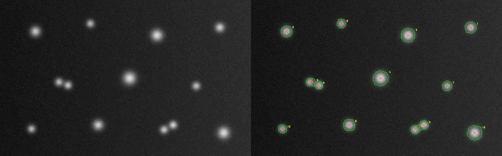

# CVL

**CVL** is a header-only C++17 **C**omputer **V**ision **L**ibrary built on top
of OpenCV 4, for macOS and Linux.

It collects the small algorithms and convenience wrappers that image-analysis
programs keep rewriting, mostly for finding and measuring bright or dark objects
in grayscale frames:

- background estimation over a window of frames, and temporal deflickering
- denoising and contrast / gamma / CLAHE enhancement
- thresholding (Otsu, adaptive, global, median, mode, percentile)
- connected-component labeling into blobs, with per-blob statistics
- splitting of touching blobs (iterative thresholding, erosion, watershed)
- barycenters, contours and nearest-neighbor clustering of blobs
- 16-bit to 8-bit conversion
- chessboard detection, sub-pixel corner refinement and stereo pose helpers
- drawing helpers, a named color palette and an OpenCV window wrapper

Everything lives in the `cvl` namespace and is reached through one header,
`<cvl/cvl.hpp>`.

---

## Install

```bash
git clone https://github.com/thewoz/CVL.git
cd CVL
make install
```

`make install` links `include/` to `/usr/local/include/cvl`, so that the headers
can be included as `<cvl/...>`. Nothing is compiled: CVL is header-only.

| Dependency | Used for |
|:-----------|:---------|
| C++17 compiler with `std::filesystem` | the library itself |
| [OpenCV 4](https://opencv.org) | images and every algorithm (`brew install opencv` / `sudo apt install libopencv-dev`) |
| `pkg-config` | lets the Makefile find OpenCV |

To use CVL in your own program, add the OpenCV flags to your build:

```bash
c++ -std=c++17 my_program.cpp -o my_program $(pkg-config --cflags --libs opencv4)
```

> Without `make install`, add `include/` to your include path and define
> `_DEBUG_CVL_LIBS_` before including `cvl.hpp`: the headers then include each
> other with local quotes (`"..."`) instead of `<cvl/...>`.

---

## Build and test

| Command | What it does |
|:--------|:-------------|
| `make install` / `make uninstall` | create / remove the `/usr/local/include/cvl` link |
| `make example` | build the example to `~/bin/cvl` |
| `make test` | build and run the test suite |
| `make test_asan` | the same suite under AddressSanitizer + UBSan |
| `make lint` | static analysis with `cppcheck` and `clang-tidy` (`brew install cppcheck llvm`) |

The test suite ([tests/test_cvl.cpp](tests/test_cvl.cpp)) builds against the
working-tree headers, creates its own synthetic inputs and prints
`ALL <n> CHECKS PASSED` on success. What each check covers, and what is not
tested, is described in [tests/README.md](tests/README.md).

---

## Example

A minimal program: find the bright objects of an image and outline them.

```cpp
#include <cvl/cvl.hpp>

int main() {

  cv::Mat image = cvl::open("image.png", cv::IMREAD_GRAYSCALE);

  // The filters work in place: keep the original image for the measurements.
  cv::Mat work = image.clone();
  cvl::denoising::get(work, "GAUSSIAN", 5);

  // Otsu picks the threshold by itself.
  cv::Mat binary;
  cvl::threshold::get(work, binary, "OTSU", 0, 0, 0);

  // Connected components of at least 20 pixels become blobs.
  cvl::blobs_t blobs;
  cvl::labeling::get(binary, cvl::labeling::NEXT_NEAREST_NEIGHBOURS, 20, blobs, image);

  for(size_t i=0; i<blobs.size(); ++i)
    printf("%d %.2f %.2f %zu\n", blobs[i].label, blobs[i].baricenter.x, blobs[i].baricenter.y, blobs[i].size());

  cv::Mat result;
  cv::cvtColor(image, result, cv::COLOR_GRAY2BGR);
  blobs.drawContours(result, cvl::lime);

  cvl::save(result, "result.png");

  return 0;

}
```

The full example, [`src/main.cpp`](src/main.cpp), needs no input data: it draws
a synthetic frame, runs the same pipeline, splits the spots that touch and
labels every object. Its output, with the frame on the left and the result on
the right:



```bash
make example
~/bin/cvl result.png
```

---

## Modules

| Header | Namespace | Purpose |
|:-------|:----------|:--------|
| `background` | `cvl::background` | Background estimation (lightest, darkest, median, mode, average, bucket, fixed) |
| `baricenter` | `cvl::baricenter` | Barycenter computations (geometric / intensity weighted) |
| `blob` / `blobs` | `cvl` | `blob_t` / `blobs_t` data structures and drawing helpers |
| `blobSplitting` | `cvl::blobsplitting` | Blob splitting via iterative thresholding + watershed |
| `chessboard` | `cvl::chessboard`, `cvl` | Checkerboard / circle-grid detection and `chessboard_t` |
| `clustering` | `cvl::clustering` | Nearest-neighbor clustering of blobs |
| `colors` | `cvl` | Named BGR color palette and the `colors` lookup class |
| `contours` | `cvl::contours` | Internal / external contour extraction, contour scaling |
| `convert` | `cvl::convert` | 16-bit → 8-bit conversions (several modes) |
| `corners` | `cvl` | `corners_t` loader for tracked corners |
| `deflickering` | `cvl` | `deflickering_t`, temporal deflickering helper |
| `denoising` | `cvl::denoising` | Denoising filters (gaussian, median, morphology, bilateral, starflag, …) |
| `draw` | `cvl::draw` | Drawing primitives (dashed circle, cross) |
| `enhance` | `cvl::enhance` | Contrast / gamma / CLAHE / unsharp / histogram equalization |
| `labeling` | `cvl::labeling` | Connected-components labeling into blobs |
| `opencv` | `cvl` | OpenCV helpers (I/O, resize, histograms, text/markers, operators) |
| `pose` | `cvl::pose` | Pose / stereo utilities |
| `subpixel` | `cvl::subpixel` | Sub-pixel corner refinement (old `cv::cornerSubPix` + new ROCHADE-like detector) |
| `threshold` | `cvl::threshold` | Thresholding utilities (otsu, adaptive, global, median, mode, percentile) |
| `utils` | `cvl::io`, `cvl::log`, `cvl::utils`, `cvl` | Self-contained helpers: path/file I/O, logging, `loader_t`, clustering primitives, `itoa`/`decToHex` |
| `window` | `cvl` | `window_t`, an OpenCV window wrapper with event hooks |

Most modules have a `get()` function that picks the algorithm by name
(`"OTSU"`, `"GAUSSIAN"`, `"MEDIAN"`, …) and lists the valid names when the one
given is unknown.

---

## Good to know

- Unless stated otherwise, functions assume single-channel 8-bit (`CV_8UC1`) images;
  color or 16-bit inputs are only supported where explicitly documented
  (`convert`, `histogram16bit`, `open16bitC1`, `background::lightest/darkest/avg`, …).
- Error handling is fail-fast: `cvl::log::error()` prints to `stderr` and calls
  `abort()`. The library does not throw recoverable exceptions.
- The library is **not thread-safe** (lazy-initialized color palette, global
  detector parameters in `subpixel`, shared window registry in `window_t`).
- Barycenters follow a pixel-center convention: the `baricenter::*` functions add
  **+0.5** to the averaged integer pixel coordinates.
- The optional `mask` of the `threshold::*` functions must be a `CV_8UC1` image of
  the same size as the input (validated, fail-fast); the mask is applied to the
  *output* only and does not affect the computed threshold.
- `deflickering_t::deflicker()` needs at least `deflickerTime` images and one
  `getLocalMean()` per image, in the same order (validated, fail-fast).
- `blobs_t::save()` writes the blob **maximum** intensity in the last column by
  default; pass `"MIN"` or `"MEAN"` as the last argument for the other two.
- `corners_t` rejects frame indices outside `[0, corners_t::MAX_FRAME_INDEX]`
  (10000) as corrupted input files.
- All the color palette values (`cvl::red`, `colors::get`, ...) are **BGR**;
  `colors::getRGBHex()` converts them to `#RRGGBB` hex strings.

---

## TODO, known issues and license

Open work and pending decisions are in [TODO.md](TODO.md) (in Italian).

CVL is licensed under the **GNU General Public License v3.0**, see
[LICENSE](LICENSE).
